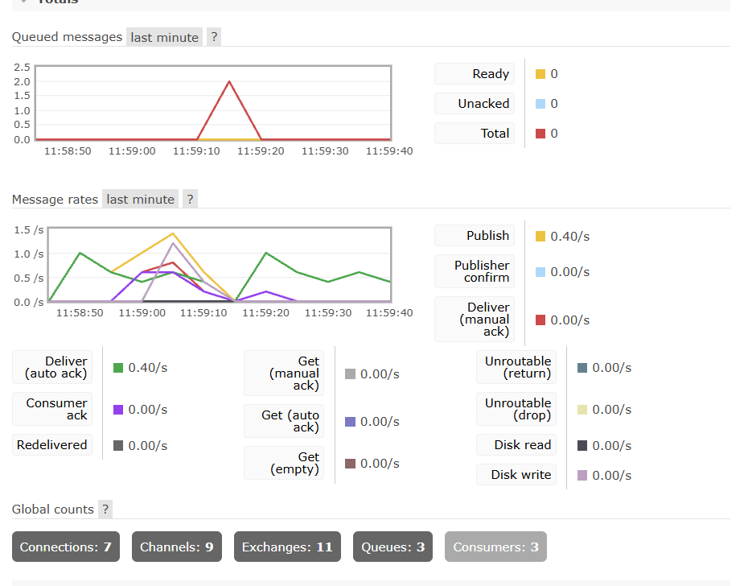

# Distributed Task System

A production-grade, microservices-based distributed task queue. This system accepts HTTP requests, queues them as background jobs, and processes them asynchronously across worker nodes using Celery, RabbitMQ, and Redis.

## Why This Architecture?

Instead of running heavy background tasks inside the API process, this system uses a message broker to decouple the API from the workers. This provides:
- **Non-blocking API:** The API returns `202 Accepted` immediately while tasks process in the background.
- **Horizontal Scaling:** You can spin up 10 Celery workers without changing the API code.
- **Resilience:** If a worker crashes mid-task, the message broker re-queues the job so no data is lost.
- **Traffic Spikes:** The queue absorbs 10,000 concurrent requests while workers process them at their own pace.

## Architecture

```text
┌─────────────┐       ┌─────────────┐       ┌─────────────┐
│   Client    │──────▶│   FastAPI   │──────▶│  RabbitMQ   │
│ (Swagger UI)│       │  (API/App)  │       │  (Broker)   │
└─────────────┘       └─────────────┘       └─────────────┘
                             │                     │
                             ▼                     ▼
                      ┌─────────────┐       ┌─────────────┐
                      │    Redis    │◀──────│   Celery    │
                      │ (Results DB)│       │  (Workers)  │
                      └─────────────┘       └─────────────┘
```

## Tech Stack

- **API:** FastAPI, Uvicorn, Pydantic
- **Task Queue:** Celery
- **Message Broker:** RabbitMQ (with management UI)
- **Result Backend:** Redis
- **Deployment:** Docker & Docker Compose

## Features

- **Asynchronous Processing:** Submit long-running tasks without blocking the API.
- **Distributed Workers:** Celery workers pull from the queue independently.
- **Automatic Retries:** Failed tasks automatically retry with a delay (exponential backoff).
- **Real-time Tracking:** Poll the REST API to check task status (`PENDING`, `STARTED`, `SUCCESS`, `RETRY`).
- **Observability:** Monitor queue metrics in real-time via the RabbitMQ web dashboard.

## Quick Start

**1. Start the stack:**

```bash
git clone https://github.com/codingbetas/distributed-task-system.git
cd distributed-task-system/docker
docker compose up --build
```

**2. Access the services:**
- **API Swagger UI:** [http://localhost:8000/docs](http://localhost:8000/docs)
- **RabbitMQ Management:** [http://localhost:15672](http://localhost:15672) (guest / guest)

## Usage

1. Open the Swagger UI.
2. Use `POST /tasks/submit` to submit a job:
   ```json
   { "filename": "annual_report.pdf" }
   ```
3. Copy the returned `task_id`.
4. Use `GET /tasks/status/{task_id}` to track progress.
5. Watch the worker terminal to see the background processing in real-time.

## Observability

Because this system uses RabbitMQ, you can visually monitor the message queue and worker consumption rates in real-time.



## Scaling

Because the workers are decoupled from the API, you can scale the worker pool horizontally with a single Docker command:

```bash
docker compose up -d --scale celery_worker=3
```

The RabbitMQ broker will automatically round-robin tasks to the available workers.

## Project Structure

```text
.
├── backend/
│   ├── app/
│   │   ├── tasks/          # Celery task definitions
│   │   ├── routes/         # FastAPI endpoints
│   │   ├── models/         # (Placeholder for future DB models)
│   │   └── celery_app.py   # Celery configuration
│   ├── Dockerfile
│   └── requirements.txt
└── docker/
    └── docker-compose.yml  # Orchestration for 4 services
```

## License

MIT